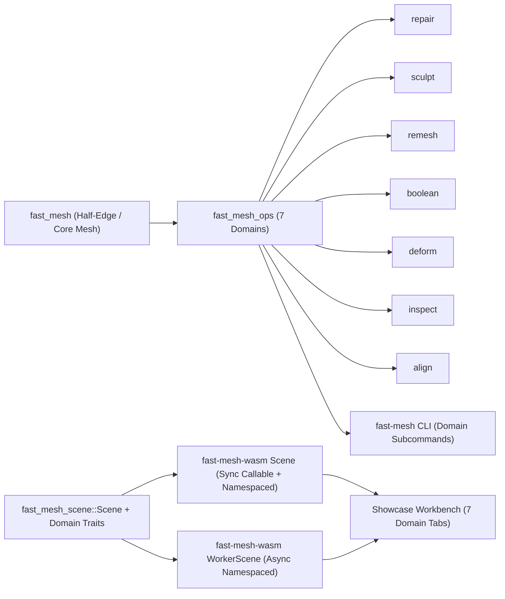

# Domain-Separated Architecture (`repair`, `sculpt`, `remesh`, `boolean`, `deform`, `inspect`, `align`)

`fast-mesh-wasm` organizes mesh processing across Rust crates, `Scene` / `WorkerScene` TypeScript namespaces, CLI subcommands, and Showcase workbench navigation around seven cohesive operational domains while preserving full backwards compatibility with legacy flat entry points.

## Domain Architecture Overview

## Cross-Stack Mapping Matrix

| Domain | Rust (`fast_mesh_ops`) | Rust (`fast_mesh_scene` Trait) | TypeScript (`Scene` & `WorkerScene`) | CLI (`fast-mesh`) | Showcase Tab |
| :--- | :--- | :--- | :--- | :--- | :--- |
| **`repair`** | `analyze`, `auto_repair`, `weld`, `cleanup`, `orient`, `fill`, `bridge`, `manifold`, `self_intersect`, `sliver` | `SceneRepairOps` | `scene.repair(...)` + `autoRepair`, `clean`, `weld`, `removeDegenerate`, `removeSmallComponents`, `orient`, `fillHoles`, `bridge`, `bridgeLoops`, `join`, `makeManifold`, `resolveSelfIntersections`, `cleanupSlivers`, `analyze` | `fast-mesh repair auto <in> -o <out>` | Repair |
| **`sculpt`** | `inflate`, `smooth`, `grab`, `flatten`, `crease`, `clay`, `twist`, `filter`, `plane`, `stroke`, `split_stretched` | `SceneSculptOps` | `scene.sculpt(...)` + `beginStroke`, `dab`, `endStroke`, `cancelStroke`, `filter`, `inflate`, `smooth`, `relax`, `grab`, `flatten`, `crease`, `clay`, `twist`, `captureStrokeState`, `captureRestSizes`, `splitStretched`, `verticesInSphere` | — | Sculpt |
| **`remesh`** | `remesh`, `simplify`, `subdivide`, `marching_cubes` | `SceneRemeshOps` | `scene.remesh` (`remesh`, `region`, `simplify`, `subdivide`, `voxel`) | `fast-mesh remesh simplify\|subdivide <in> -o <out>` | Remesh |
| **`boolean`** | CSG `boolean_plan`, `apply_boolean`, `cut_by_plane`, `offset`, `shell` | `SceneBooleanOps` | `scene.boolean(...)` + `union`, `difference`, `subtract`, `intersection`, `intersect`, `cut`, `cutByPlane`, `offset`, `shell` | `fast-mesh boolean union\|intersection\|difference <a> <b> -o <out>` | Boolean |
| **`deform`** | `sculpt::*` + `protect` (`check_protection`, `with_protection`, `with_protection_band`) | `SceneDeformOps` | `scene.deform` (`inflate`, `smooth`, `relax`, `relaxed`, `grab`, `flatten`, `crease`, `clay`, `twist`, `protect`) | — | Deform |
| **`inspect`** | `analyze`, `measure`, `measure_placed`, `topology` (`boundary_loops`, `BoundaryLoop`, `Component`, `EdgeKind`, `LoopId`) | `SceneInspectOps` | `scene.inspect` (`analyze`, `measure`, `bounds`, `raycast`, `closestPoint`, `meshDistance`, `intersects`, `findContacts`, `addDistanceField`, `addThicknessField`, `addCurvatureField`, `removeField`, `fieldValues`, `fieldNearest`, `fieldStatus`, `fieldTargetStatus`, `setColoring`, `coloring`, `addSection`, `setSectionPlane`, `sectionPlane`, `setSectionMeshes`, `setSectionFill`, `removeSection`, `section`, `sectionGap`, `updateSections`) | `fast-mesh inspect measure\|analyze <in>` | Inspect |
| **`align`** | `icp`, `sample_surface`, `IcpOptions`, `IcpReport`, `IcpStatus`, `IcpMotion` | `SceneAlignOps` | `scene.align` (`register`) | — | Align |

## Backwards Compatibility & Migration Notes

- **Rust `fast-mesh-ops`**: All historical top-level crate exports remain intact alongside `fast_mesh_ops::{repair, sculpt, remesh, boolean, deform, inspect, align}`.
- **Rust `fast-mesh-scene`**: `Scene` retains its inherent methods while implementing the seven extension traits (`SceneRepairOps`, `SceneSculptOps`, `SceneRemeshOps`, `SceneBooleanOps`, `SceneDeformOps`, `SceneInspectOps`, `SceneAlignOps`).
- **Rust `fast-mesh-cli`**: Legacy flat commands (`fast-mesh repair <in> -o <out> --auto`, `fast-mesh measure <in>`, `fast-mesh boolean <a> <b> --op ...`) remain fully supported alongside `fast-mesh <domain> <action>`.
- **TypeScript `fast-mesh-wasm`**:
  - `scene.repair(...)`, `scene.sculpt(...)`, and `scene.boolean(...)` are callable namespaces so existing calls continue working identically alongside `scene.repair.autoRepair(...)`, `scene.sculpt.beginStroke(...)`, and `scene.boolean.union(...)`.
  - Legacy convenience methods (`analyze`, `measure`, `register`, `cutByPlane`, `join`, `verticesInSphere`, `raycast`, `closestPoint`, `meshDistance`, `intersects`, `findContacts`, `addDistanceField`, `addThicknessField`, `addCurvatureField`) remain live with `@deprecated` JSDoc pointers and zero runtime `console.warn`.
